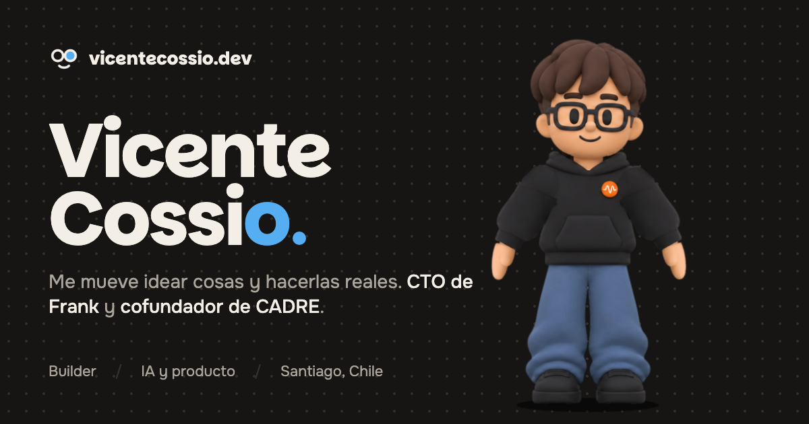
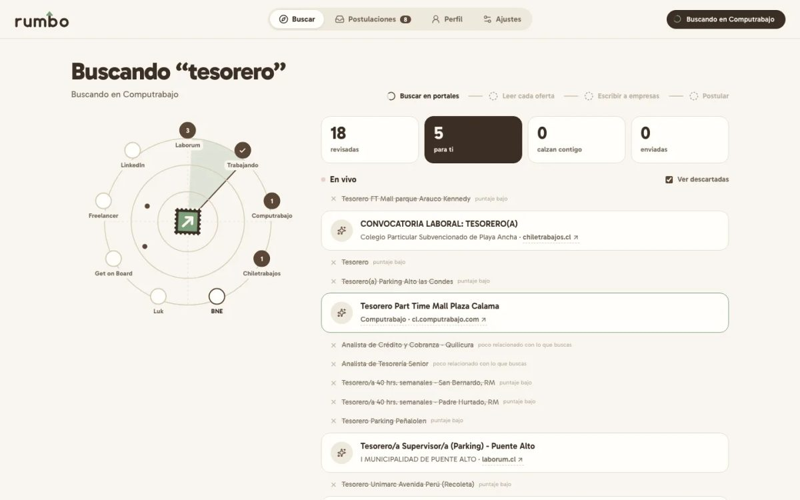
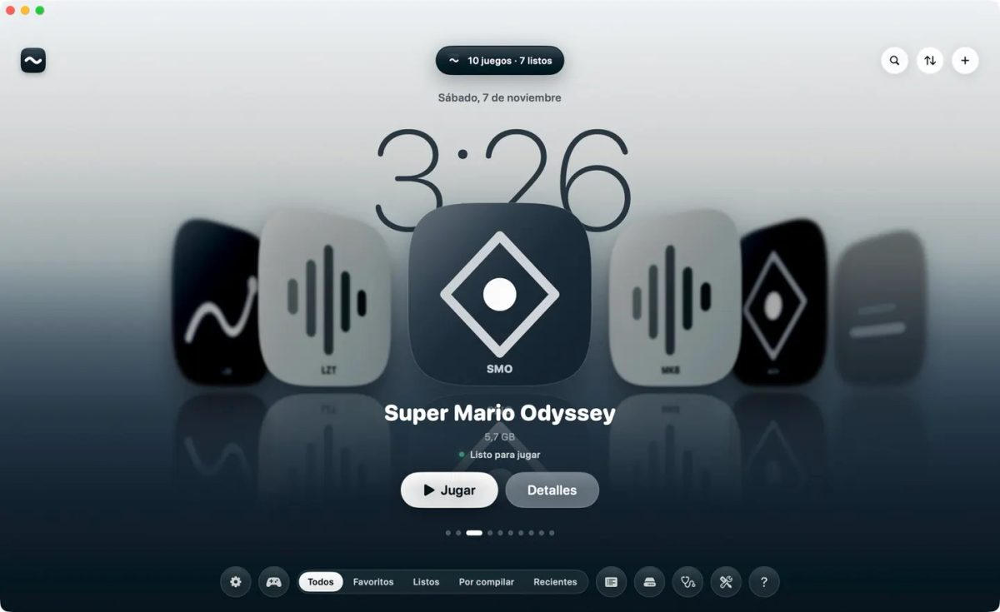
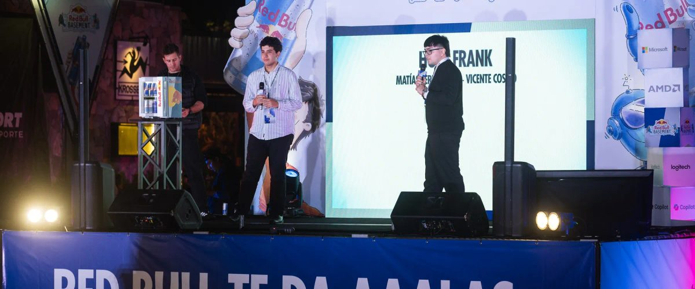

## Hola, soy Vicente

Tengo 20 años, soy de Santiago de Chile y me mueve una cosa: **idear cosas y hacerlas reales**.

Disfruto todo el recorrido: pensar la idea, armar el equipo, construir el producto y sostenerlo hasta que funciona. Emprender no es mi plan B, es mi forma de construir. Empecé vendiendo dulces en el colegio y ropa en la feria; hoy construyo con IA.

> La tecnología es la herramienta. El problema que me interesa resolver siempre es humano.

## Lo que construyo

**[Frank](https://www.tryfrank.app)**, CTO y cofundador. IA por voz para que los equipos practiquen las conversaciones difíciles antes de tenerlas: una persona de IA que reacciona como alguien real y un informe de cómo lo dijiste. Lidero el producto y al equipo técnico (Next.js, Supabase, voz en tiempo real, agentes con Claude en Amazon Bedrock y AWS).

**[CADRE](https://www.cadre.cl)**, cofundador. Software a medida y automatizaciones con IA para empresas: apps web, CRM, dashboards, integraciones y flujos con n8n. Ahí nacieron [Electrificarte](https://electrificarte.com), el portal para elegir tu auto eléctrico en Chile, y proyectos como Eufórica y [Anamoure](https://anamoure.me).

*El código de Frank, CADRE y sus clientes es privado; los productos están en vivo en sus links.*

## Open source

<table>
<tr>
<td width="50%" valign="top">

<h3><a href="https://github.com/vizzeuk/rumbo">Rumbo</a></h3>
Tu búsqueda de trabajo en piloto automático. Revisa 13 portales, lee cada oferta con IA, te explica por qué calza contigo y redacta la postulación con tu perfil. Todo queda en tu computador.  
Python · Playwright · IA
</td>
<td width="50%" valign="top">

<h3><a href="https://github.com/vizzeuk/ondi">Ondi</a></h3>
Tus juegos de consola convertidos en apps nativas de Mac. No es un emulador: el código corre directo en el chip y los gráficos se reconstruyen con Metal.  
Swift · Metal · macOS
</td>
</tr>
</table>

## Algunas cosas que han pasado

- 🏆 Ganamos **Red Bull Basement Chile 2026** entre más de 2.000 proyectos.
- 🌎 **Top 40 mundial** en San Francisco, entre más de 140.000 ideas. Presenté ante líderes de Microsoft, Replit y GitHub, en mi primer viaje fuera de Chile.
- 🎤 Speaker en AWS Student Community Day Chile y expositor en el Summit de IA Aplicada de Duoc UC.
- 🚀 Frank está en los programas de startups de AWS, NVIDIA y Cartesia.

## Lo que creo

Mientras la IA hace cada vez más tareas técnicas, las habilidades humanas serán la principal ventaja. Quiero usar la tecnología para potenciarlas, no para reemplazarlas.

Y algo que aprendí en el camino: la barrera casi nunca es técnica, es el miedo al *"¿y si me va mal?"*. Si yo pude construir esto, tú también puedes construir lo tuyo.

## Con lo que trabajo

**Lenguajes** TypeScript, JavaScript, Python, Swift, SQL
**Producto** Next.js, React, Tailwind, Node.js, FastAPI
**Datos y nube** Supabase, PostgreSQL, AWS (CDK, ECS, Lambda, S3, SQS, Bedrock), Cloudflare, Docker
**IA y automatización** agentes, voz en tiempo real, RAG, Claude, OpenAI, Gemini, n8n
**Cómo trabajo** desarrollo asistido por IA todos los días, SDD y TDD, Pull Requests, CI y Scrum

Fuera del código: videojuegos (God of War, Uncharted, The Last of Us, Spider-Man, Devil May Cry) y emprender. Una partida más y vuelvo.

---

<a href="https://www.vicentecossio.dev"><b>vicentecossio.dev</b></a> &nbsp;·&nbsp;
<a href="https://www.linkedin.com/in/vicente-cossio">LinkedIn</a> &nbsp;·&nbsp;
<a href="mailto:vicentecossio.dev@gmail.com">vicentecossio.dev@gmail.com</a>

